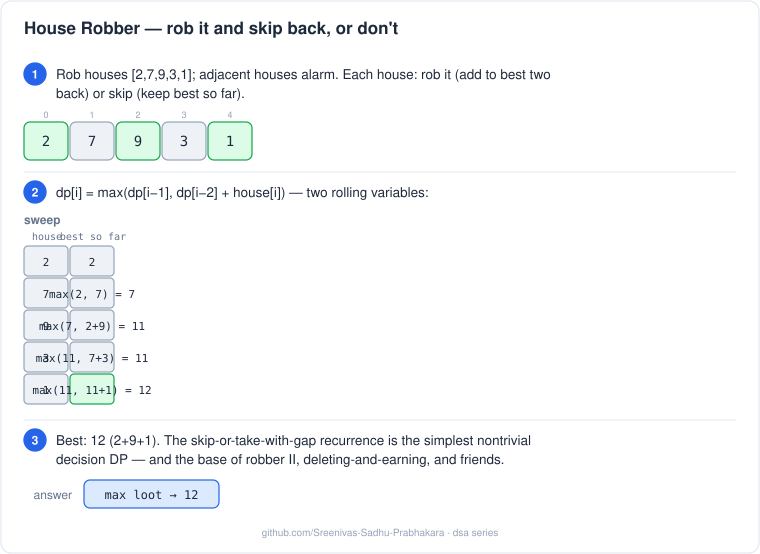

# House Robber

> NeetCode 150 · 1-D DP · Blind 75 — two running states, rob-previous and skip-previous, updated in one parallel assignment per house. Go, stdlib only, tested.

## Problem

Maximize loot from a row of houses where robbing two adjacent ones trips the alarm. The archetype of "take or skip with a one-step exclusion".

## Approach

At each house only one bit of history matters: was the previous house robbed? Carry both regimes — `robbed` (best total where the last house was taken) and `skipped` (best where it wasn't) — and update them together: robbing this house extends only the skipped regime (`skipped + v`), while skipping it inherits the better of both. Go's parallel assignment makes the simultaneous update natural and bug-resistant (no temp variable to forget). This two-state scan is the base pattern that House Robber II (circular, dsa-235) and stock-with-cooldown (dsa-256) decorate.

**Complexity:** O(n) time, O(1) space.

## Visual walkthrough

Read the picture top to bottom — each numbered frame is one moment of the algorithm
running on this repo's test example.

## Run

    go test ./...   # verify
    go run .        # demo

---

Part of a 275-repo DSA series in Go — Striver's SDE Sheet (dsa-001–191) plus the NeetCode 150 / Blind 75 additions (dsa-192–275), stdlib only, every solution tested. Browse: [`dsa-*` repos](https://github.com/Sreenivas-Sadhu-Prabhakara?tab=repositories&q=dsa-&type=source).
